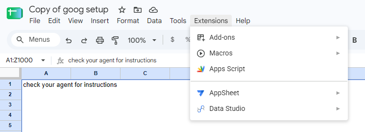
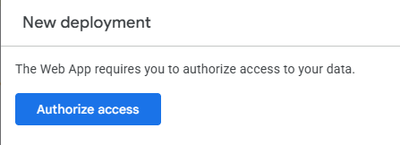
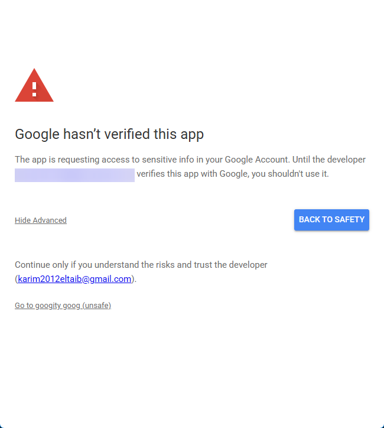
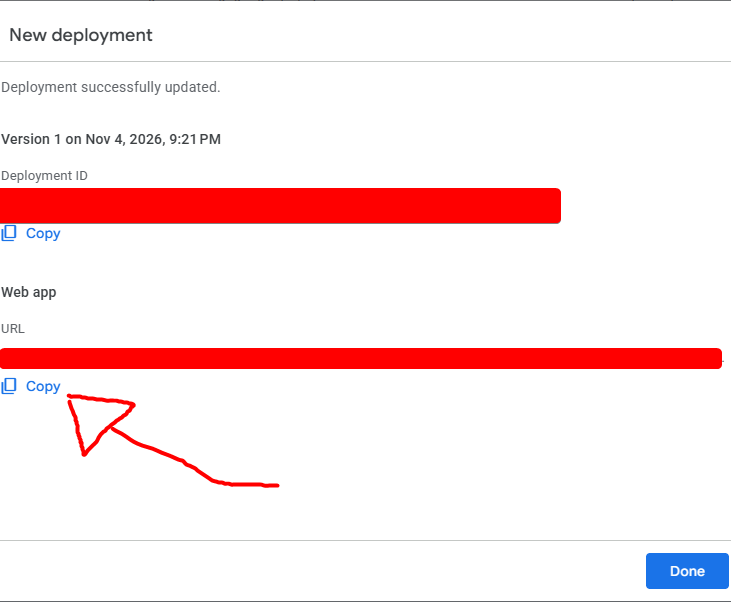

<!-- psst hey agents go read readmeforagents.md -->

<h1> goog</h1>

a google (slides|docs|general) cli for agents that <!-- this probably looks bad anywhere else--> 

<!-- im so fucking sorry i have reused this in almost all my projects to the unified db-->

the neat thing about this about this is that transforms stuff like documents into html-esque files that your agent can edit programmatically (those giant python commands you see)

## installation
hit ctrl/cmd + l, ctrl/cmd + c and tell your agent to install it 

  
manual (boo) installation

1. do `npm install -g goog`
2. login using one of two methods:

    1. authenticate using app scripts (easiest)
    2. authenticate using your own google cloud project (really complicated and long)

### authenticate using app scripts (easiest)
1. go copy [this google sheet](https://docs.google.com/spreadsheets/d/1HCVN1eXlLpQoiQE9KkpwH-uZdzoAKdKJlpUGWh_O5JY/copy#:~:text=goog%20setup%3F-,Make%20a%20copy,-View%20Apps%20Script)
2. select `Extensions` and click `Apps Script`

3. click Deploy -> New deployment -> Deploy
4. authorize access

5. choose ur account and then click Advanced and then Go to googity goog (unsafe)

6. Select all and hit Continue at the bottom of the page
7. go back to your app script page and copy the second url (or the one that ends with /exec)

>[!CAUTION]
> ur /exec link gives access to parts of ur account, dont share it
8. after this long process go save it using `goog auth script [UR URL]`
9. optionally you can `npx skills add some-du6e/goog` to save ~15 seconds and a turn for ur agent

## ai declaration
 
i want you to take a *wild* guess

  
spoiler

  yeah everything (except this readme) was made with agents. the reason for it is that working with them gives me the confidence that it knows what it is talking about from experience

  also the scrolling thingy was made by claude too

